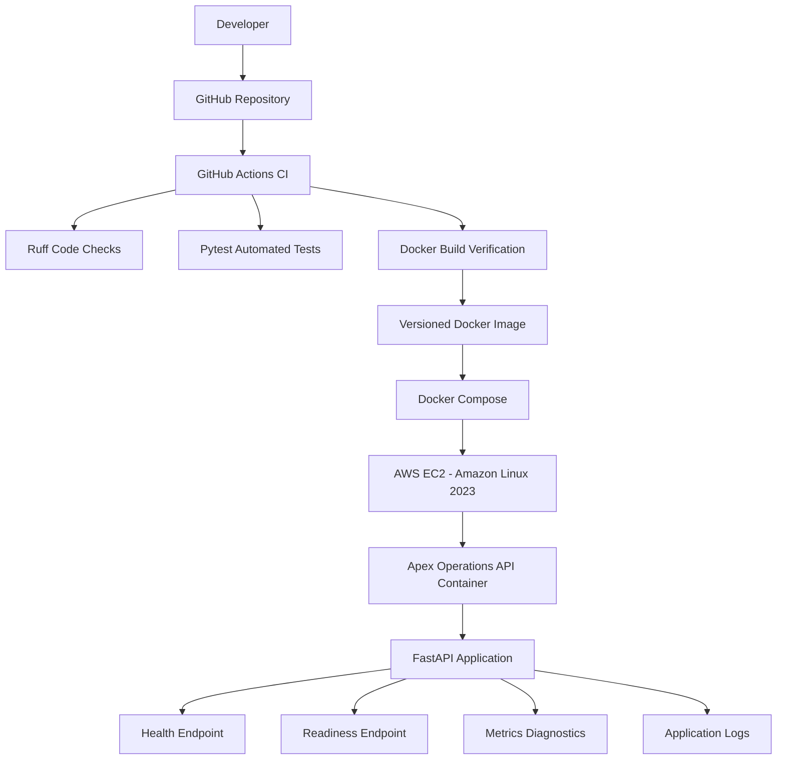

# Apex Operations API — Architecture

## 1. Architecture Overview

The application follows a simple containerized architecture. Developers push source code to GitHub, where GitHub Actions performs automated quality checks, tests, and Docker build verification.

The application is packaged as a Docker image and deployed using Docker Compose on an AWS EC2 Linux environment.

## 2. Architecture Diagram

## 3. Main Components

| Component | Responsibility |
|---|---|
| GitHub | Source code management |
| GitHub Actions | Automated CI workflow |
| Ruff | Python code quality checks |
| Pytest | Automated application testing |
| Docker | Application containerization |
| Docker Compose | Container deployment and configuration |
| AWS EC2 | Linux host environment |
| FastAPI | API framework |
| Uvicorn | Application server |

## 4. Application Flow

1. The developer updates the application source code.
2. Changes are pushed to the GitHub repository.
3. GitHub Actions starts the CI workflow.
4. Ruff checks code quality and Pytest executes automated tests.
5. Docker builds the application image.
6. The image is deployed using Docker Compose.
7. The API provides health, readiness, and diagnostic endpoints.
8. Application request information is written to container logs.

## 5. Deployment Design

The application runs inside a Docker container on an AWS EC2 Linux host.

The host exposes the application on `127.0.0.1:8080`, which forwards traffic to port `8000` inside the container.

Docker Compose uses the `APP_VERSION` environment variable to select a versioned image. This supports controlled releases and rollback to a previously built image.

## 6. Design Considerations

- Keep the application isolated inside a container.
- Use automated checks before accepting code changes.
- Use explicit image versions for release management.
- Keep the API bound to localhost in the current deployment.
- Provide health and readiness endpoints for operational checks.

## 7. Scope

This is an assessment demonstration architecture. It does not represent Apex AI Arabia's internal production infrastructure and does not connect to production systems or customer data.
